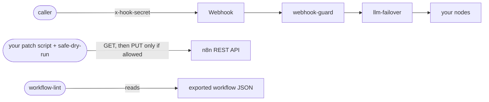

# n8n-production-kit

Four small tools I use to run n8n in production, and a list of the n8n behaviours that
failed on me without an error. Each tool is one short file you can read in a few minutes,
with an importable demo workflow and tests that run offline, with no keys.

| Tool | What it does | Language |
|---|---|---|
| [llm-failover](llm-failover/) | Calls an LLM and moves to the next key, then the next model, when one fails. One deadline, no sleeps. | Code node (JS) |
| [webhook-guard](webhook-guard/) | Refuses a webhook call without the right secret header. | Code node (JS) |
| [safe-dry-run](safe-dry-run/) | One import, and a script's `--check` can no longer write to n8n. | Python |
| [workflow-lint](workflow-lint/) | Checks exported workflows for three mistakes that fail silently. | Node CLI |
| [GOTCHAS.md](GOTCHAS.md) | n8n behaviours that look like success and are not. | - |

## Run it

You need Node 18 or later and Python 3.9 or later. There is nothing to install.

```bash
git clone https://github.com/shinabaze/n8n-production-kit
cd n8n-production-kit
node --test
python -m unittest discover -s safe-dry-run
node llm-failover/example.mjs
python safe-dry-run/demo.py
node workflow-lint/lint.mjs workflow-lint/fixtures
```

The last command exits 1 on purpose: three of its fixtures are built to fail.

To try a tool inside n8n, open Workflows, choose Import from File, and pick that tool's
`demo-workflow.json`. The Code node tools read keys from the n8n environment, see
[`.env.example`](.env.example).

## Where each piece sits



The two Code nodes run inside a workflow. The other two run on your machine or in CI,
around the instance: one guards the scripts that change it, the other reads what it exports.

## A worked example

Ten items need an LLM answer. I have three keys. The first model is rate-limited on two of
them and hangs on the third. `node llm-failover/example.mjs` simulates exactly that:

```
item  1: gemini-flash-lite-latest on LLM_KEY_1
           after gemini-flash-latest/LLM_KEY_1: 429 Resource has been exhausted
           after gemini-flash-latest/LLM_KEY_2: 429 Resource has been exhausted
           after gemini-flash-latest/LLM_KEY_3: NET timeout of 60000ms exceeded
item  2: gemini-flash-lite-latest on LLM_KEY_1
...
13 calls for 10 items. Without sharing what item 1 learned, each item makes 4: 40 calls.
```

Item 1 pays for finding out. The other nine skip straight to a pair that works. In a real
run the hang costs one 60 second timeout instead of ten.

## What I learned

**Green is not working.** Almost everything in [GOTCHAS.md](GOTCHAS.md) reported success.
A node on "continue on error", a run that times out, a webhook that answers 200 while it
refuses: each one looks fine in the editor. Test the side effect, not the tick.

**Make the safe path the default.** A check that can write, a guard that opens up when its
secret is missing, a failover that sleeps: each is one line away from right, and that line
is easy to get wrong in a hurry. I would rather the tool refuse than trust the script.

**Break the code to prove the test.** A test that passes against the bug proves nothing. I
checked the main tests here by putting each bug back and watching the suite fail.

## Limits

- These are small on purpose. Each tool's README lists what it does not cover.
- llm-failover speaks Gemini's request format. Two functions change for another provider.
- safe-dry-run only sees HTTP made through Python's `http.client`.
- workflow-lint has three rules and no config.

The reasons behind the main choices are in [docs/decisions.md](docs/decisions.md). If you
are new to n8n, start with [docs/explained.md](docs/explained.md).

## Licence

MIT. See [LICENSE](LICENSE).
